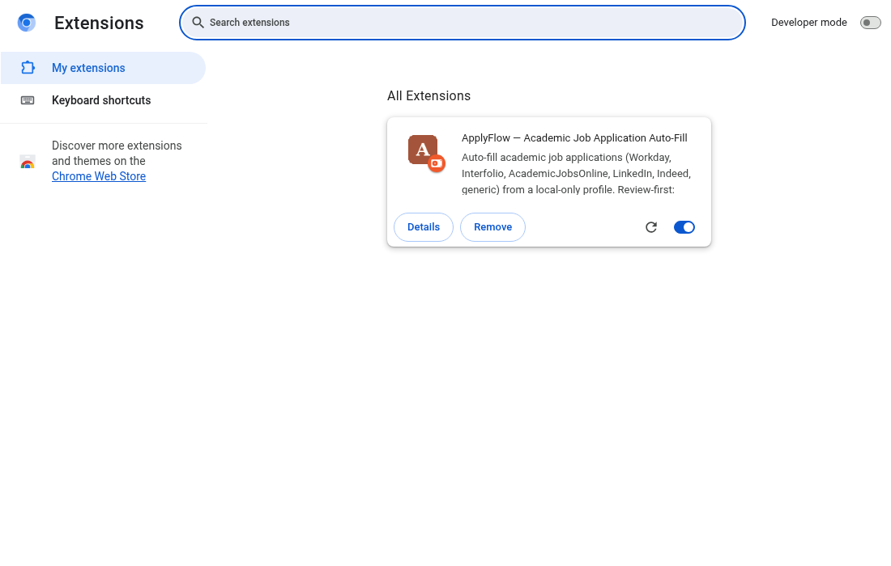
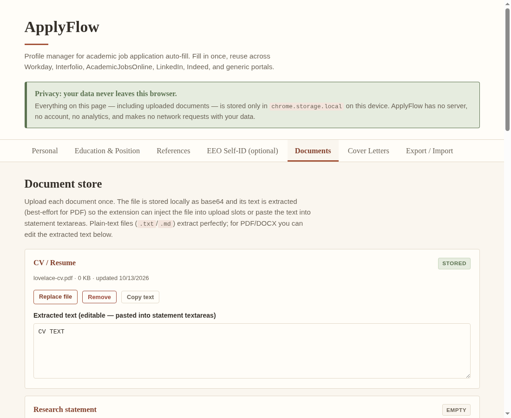
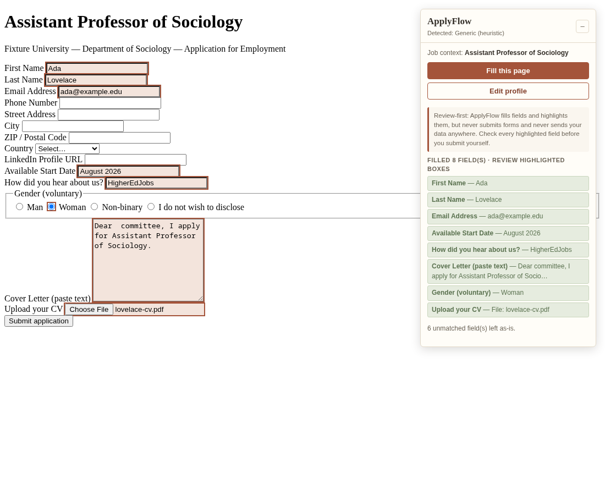

# ApplyFlow

Auto-fill academic job applications from a reusable, **local-only** profile.
Manifest V3 browser extension for Chrome and Firefox. Vanilla JS, no build
step, no CDN dependencies, no remote code, no analytics.

**Review-first design:** ApplyFlow fills fields and highlights everything it
touched, but it **never submits a form** and never sends your data anywhere.
Your profile and documents live only in `chrome.storage.local` on your device.

## What it does

- **Profile manager** (options page): personal info & links (homepage, Google
  Scholar, ORCID, LinkedIn), education history, current position, any number
  of references, optional EEO self-ID answers, and reusable answers to common
  questions (start date, salary, "how did you hear").
- **Document store**: CV, research / teaching / diversity / personal
  statements, transcripts — uploaded once, stored locally as base64 with
  extracted text, injected into file-upload slots via `DataTransfer`/`File`
  where the site allows (otherwise a clear "attach manually" badge appears
  next to the slot).
- **Cover-letter templates**: multiple named templates with
  `{{position}}`, `{{department}}`, `{{university}}`, `{{date}}` placeholders,
  substituted from the detected job context.
- **Site adapters**: Workday (`*.myworkdayjobs.com`), Interfolio
  (`apply.interfolio.com`), AcademicJobsOnline, LinkedIn Easy Apply, Indeed —
  plus a generic fallback that matches fields by label / `name` /
  `autocomplete` / `aria-label` heuristics, so unknown portals still work.
- **Floating panel** on application pages: detected adapter, job context,
  "Fill this page", per-field highlight list, manual-attention list.
- **Toolbar popup**: detected adapter display, Fill page, Edit profile,
  Copy cover letter (context-substituted), Copy document text.
- **Export / import** the whole profile (documents included) as `.json`.

## Install (load unpacked)

### Chrome / Edge / Brave

1. Clone or download this repository and unzip it somewhere permanent — the
   browser loads the folder live, so don't delete it afterwards.
2. Open `chrome://extensions`.
3. Enable **Developer mode** (toggle, top right).
4. Click **Load unpacked** and select the `applyflow` folder (the one
   containing `manifest.json`).
5. Pin ApplyFlow to the toolbar (puzzle-piece icon → pin).



### Firefox (temporary add-on)

Firefox MV3 uses event pages instead of service workers; the manifest already
declares both `background.service_worker` and `background.scripts`, so the
same folder works in both browsers (requires Firefox ≥ 121).

1. Open `about:debugging#/runtime/this-firefox`.
2. Click **Load Temporary Add-on…** and select the `manifest.json` inside the
   `applyflow` folder.
3. Temporary add-ons are removed when Firefox restarts — reload it after a
   restart, or package/sign the extension (`web-ext build` + addons.mozilla.org
   self-distribution) for permanent installation.


*(screenshot placeholder)*

## Set up your profile

1. Click the ApplyFlow toolbar icon → **Edit profile**
   (or right-click the icon → *Options*).
2. Fill in **Personal**, **Education & Position** (most recent first), and
   **References**. Everything auto-saves locally.
3. **EEO Self-ID** is optional — leave it blank and those questions are
   skipped.
4. Upload documents on the **Documents** tab. `.txt`/`.md` text extraction is
   exact; PDF extraction is best-effort, so check the extracted text and paste
   corrections into the box if needed.
5. Write cover-letter templates on the **Cover Letters** tab using the
   placeholder chips (`{{position}}`, `{{department}}`, `{{university}}`).
   The first template is the default.
6. Back up via **Export / Import** → *Export profile (.json)*.



## Using it on an application

1. Open the job application page. The floating **ApplyFlow** panel appears on
   pages that look like application forms (or always on recognized portals).
2. Click **Fill this page**. Filled fields are outlined in terracotta and
   listed in the panel; anything needing manual attention (e.g. a blocked file
   upload) gets a yellow badge.
3. Multi-step wizards (typical Workday): click **Fill this page** again after
   each *Next*.
4. **Review every highlighted field, then submit yourself.** ApplyFlow never
   submits.



## Honest limitations

- Job portals change their markup frequently; the site adapters are
  best-effort and may need selector updates. The generic label matcher is the
  safety net and covers most standard fields.
- Some portals block programmatic file uploads (`DataTransfer` injection) —
  ApplyFlow then shows an "attach manually: [document name]" badge.
- Custom dropdown widgets (not native `<select>`) can't always be set
  programmatically; those are reported for manual attention.
- PDF text extraction is a lightweight heuristic, not a full PDF parser.
- The EEO matcher picks the closest option by text similarity — always review
  its choice.
- Firefox: temporary add-on installation disappears on browser restart.

## Development & verification

No build step. All JavaScript is vanilla and loaded as classic scripts.

```
node --check on every .js file     # syntax
node test/run-tests.js             # unit tests: manifest validation, label-matcher
                                   # fixture table (60 cases), placeholder
                                   # substitution, schema validation, adapters
xvfb-run node test/e2e-playwright.js   # real-Chromium E2E (needs playwright +
                                   # xvfb; NODE_PATH pointing at global modules)
```

The E2E test loads the unpacked extension into Chromium, seeds a profile via
`chrome.storage.local`, serves `test/fixture-form.html` over HTTP, clicks the
panel's *Fill this page*, and asserts field values, select/radio handling,
cover-letter substitution, highlighting, and `DataTransfer` file injection.

## Uploading to GitHub + GitHub Pages

```
git init
git add .
git commit -m "ApplyFlow: academic job application auto-fill extension"
gh repo create applyflow --public --source=. --push   # or create via web UI
```

Then enable Pages for the landing page:

1. Repo → **Settings → Pages**.
2. Source: **Deploy from a branch**, branch `main`, folder **`/docs`**.
3. Save — the landing page (`docs/index.html`) will be published at
   `https://<user>.github.io/applyflow/`.

## Repository layout

```
manifest.json            MV3 manifest (Chrome + Firefox)
background/              service worker / event page (self-contained)
content/                 adapters, autofill engine, floating panel, entry point
profile/                 profile manager (options page)
popup/                   toolbar popup
shared/                  schema, storage, templating, field matcher
icons/                   generated PNG icons + SVG source
docs/                    GitHub Pages landing page
test/                    unit tests, fixture form, Playwright E2E
```

## License

MIT — see [LICENSE](LICENSE).
